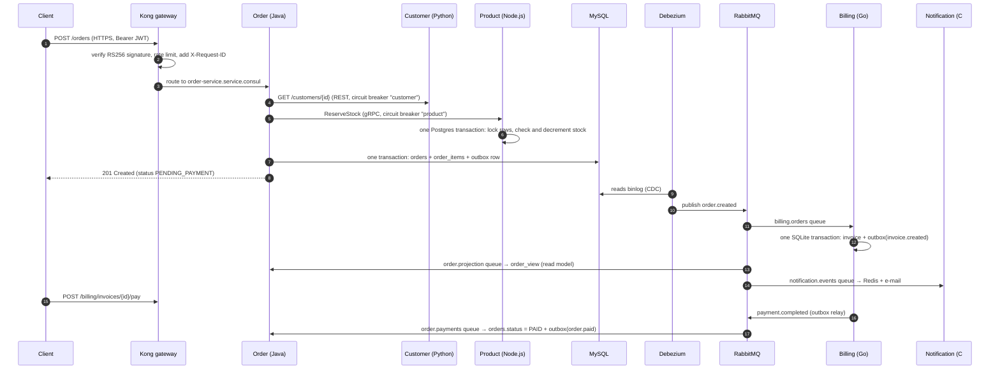

# RetailFlow architecture notes

## Services and their data

| Service | Language | Database | Owns | Talks to |
|---|---|---|---|---|
| Customer | Python / FastAPI | MongoDB | customer profiles, accounts, password hashes; **issues JWTs** | publishes `customer.registered` |
| Product | Node.js / Express | PostgreSQL | categories, products, prices, stock, stock reservations | gRPC server `ReserveStock` |
| Order | Java / Spring Boot | MySQL | orders, order items, outbox, read model | REST → Customer, gRPC → Product, consumes `payment.completed` and `order.* / invoice.* / payment.*` |
| Billing | Go | SQLite | invoices, payments, outbox | consumes `order.created`, publishes `invoice.created`, `payment.completed` |
| Notification | C# / ASP.NET Core | Redis | notification feed per customer | consumes everything, sends e-mail (SMTP) and simulated SMS |

No service reads another service's database. Data that crosses a boundary travels in an API
response or an event (for example, the customer's name and e-mail are copied into `order.created`).

## Placing an order

## Consistency model

* **ACID inside a service.** Every state change and the event that announces it are written
  in **one local transaction** (MySQL, PostgreSQL, SQLite). Either both happen or neither does.
* **No distributed transactions between services.** Instead the system is **eventually
  consistent (BASE)**: invoices, notifications and the order read model become correct a few
  hundred milliseconds after the order is saved. The order's `history` field shows the events
  arriving.
* **Transactional outbox + CDC.** Order Service never publishes to RabbitMQ directly. It inserts
  into `outbox`, and Debezium tails the MySQL **binlog** and publishes each row, so a crash
  between "save" and "publish" cannot lose or invent an event. Billing implements the same
  pattern with a **polling publisher** (it reads unpublished rows and uses publisher confirms)
  so both variants can be compared.
* **At-least-once delivery, idempotent consumers.** A message can arrive twice (after a
  crash or a retry). Consumers record the `eventId` they processed (`processed_events` tables,
  Redis `SET NX`) and ignore duplicates.
* **Retries and dead letters.** Queues are RabbitMQ quorum queues with `x-delivery-limit: 5`.
  A message that keeps failing, or cannot be parsed, moves to `<queue>.dlq` instead of blocking
  the queue.
* **CQRS.** The command side writes `orders` / `order_items`. The query side (`GET /orders`)
  reads only `order_view`, a denormalised table built by `EventListeners.project` from
  events. Reads can therefore be scaled or reshaped without touching the write model.
* **Saga (choreography).** order.created → invoice.created → payment.completed → order.paid.
  Each step is a local transaction triggered by the previous step's event.

## Resilience

* Resilience4j circuit breakers on both synchronous calls from Order Service. After 2 failures
  in the last 4 calls the circuit opens for 15 s and calls fail immediately with a clear 503,
  instead of waiting on a dead service. The gRPC call also has a 2-second deadline.
* Polly circuit breaker and timeout around SMTP in Notification Service. While it is open,
  in-app notifications are still stored and e-mails are marked `SKIPPED_CIRCUIT_OPEN`.
* Consul health checks remove unhealthy instances from DNS, so Kong only routes to healthy
  pods. Services re-register every 30 s (or via a TTL heartbeat in the Java service), so they
  recover if Consul restarts.

## Security layers

1. **Transport**: HTTPS on the gateway. Every other port is either internal or bound to `127.0.0.1`.
2. **Authentication**: RS256 JWT, 1-hour expiry, issued by Customer Service. Passwords are stored as bcrypt hashes.
3. **Authorisation**: the gateway rejects requests without a valid token, and each service verifies it again (zero trust) and checks the `role` claim and resource ownership.
4. **Abuse protection**: rate limiting (30/min on `/auth`, 300/min overall), 1 MB request limit, security response headers.
5. **Secrets**: generated at first start (JWT keys, TLS certificate) or read from `.env` / Kubernetes Secrets. Each container mounts only the keys it needs.
6. **Least privilege**: separate database users (the MySQL `order_app` user can only read and write data; `debezium` can only read the binlog). The RabbitMQ application user cannot create or delete exchanges or queues.
7. **Containers / Kubernetes**: non-root users, read-only root filesystems, all Linux capabilities dropped, seccomp, Pod Security Standards, default-deny NetworkPolicies, no service-account tokens.

## Known simplifications (say so in the viva)

* Consul runs in `-dev` mode (single node, in memory), and RabbitMQ, the databases and Consul run as single replicas.
* Payment is simulated. SMS is logged instead of sent.
* TLS ends at the gateway. Traffic inside the cluster is plain HTTP/gRPC, protected by NetworkPolicies. A service mesh (mTLS) would be the next step.
* Stock reserved for an order that is never paid is not released automatically. A real system would add an expiry plus an `order.cancelled` compensation event.
